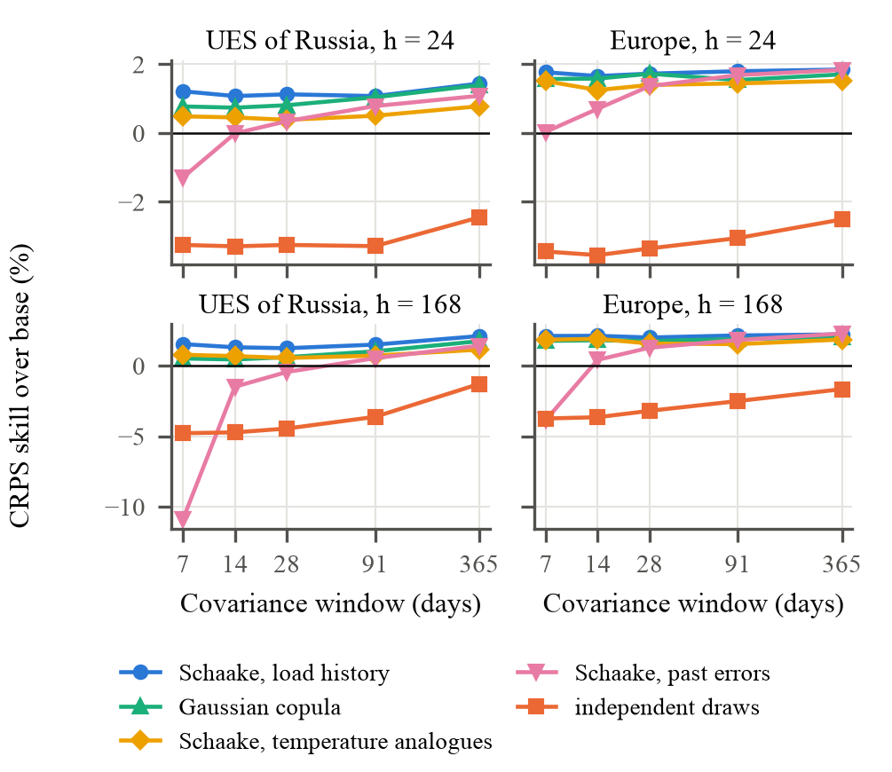
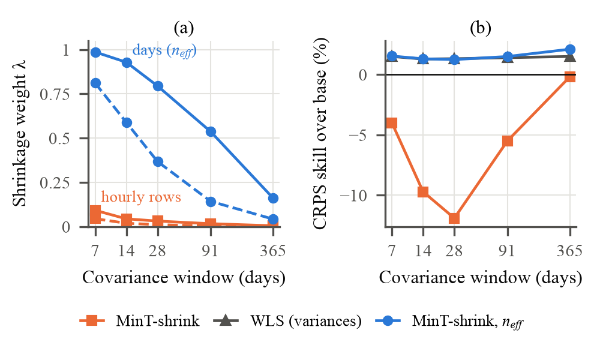

# Draft, English version

English text of the paper for REEPE 2027, the source of `make article`. Numbers come from the second full cluster run of 01.11.2026 (`paper/data/*.csv`, built by `paper/build/numbers.py`). Places still waiting for the authors are marked [CHECK].

---

## Title

**Reconciling Probabilistic Forecasts of Time Series Foundation Models in a Power System Hierarchy**

## Authors

- [CHECK: author names]
- [CHECK: academic degree, title]
- [CHECK: department], Bauman Moscow State Technical University
- 2nd Baumanskaya St., 5, bldg. 1, Moscow, 105005, Russian Federation
- [CHECK: e-mail]

## Abstract

Pretrained time series models such as Chronos-2 and TimesFM forecast every node of a power system on its own, so their forecasts do not add up across the grid hierarchy. We reconcile their probabilistic forecasts on the Unified Energy System of Russia (81 nodes) and on a European hierarchy (22 nodes) over 356 daily forecast origins. If sample paths are drawn independently per node, every coherent method with a covariance window of up to three months is worse than the base forecasts. If the draws are ordered by the Schaake shuffle with past load anomalies, reconciliation improves the CRPS by 1.1–2.1% in Russia and by 1.7–2.5% in Europe. MinT-shrink also needs forecast days, not hours, as its sample size: otherwise its shrinkage weight falls to 0.03 and the weekly forecasts lose 12%. Weaker base models gain more, up to 9%.

## Index Terms

hierarchical forecasting, forecast reconciliation, probabilistic load forecasting, time series foundation models, Schaake shuffle, covariance shrinkage

---

## I. Introduction

A system operator forecasts electricity demand at several levels of the grid: the whole system, interconnected power systems (IPS) and regions. The forecasts of one level must add up to the level above, otherwise dispatch and market planning receive contradicting numbers. Forecast reconciliation makes a set of independent forecasts coherent. The MinT method [1], [2] projects the base forecasts onto the coherent subspace with a weight matrix built from the covariance of their errors. A review of the field is given in [3].

Pretrained time series models (foundation models) changed the base forecasts. Chronos [4], Chronos-2 [5], TimesFM [6] and TimesFM 3.0 [7] forecast a series without training on it, and on electrical load they are competitive with models trained for the task [8]. These models are a natural source of base forecasts for a hierarchy, but they bring two problems for reconciliation. First, they return marginal quantiles for each node and say nothing about the joint distribution of nodes. Second, they have no fitted residuals, so the error covariance can be estimated only from the forecasts issued so far, which for a new deployment means a few weeks.

Probabilistic reconciliation projects every sample path of the joint forecast distribution with the same matrix [9], [10]. Its result depends on how the joint paths are built. Ben Taieb et al. [11], [12] reconcile electricity demand with paths reordered by an empirical copula of in-sample residuals. Jeon et al. [13] study probabilistic reconciliation of wind power and electric load. In weather forecasting the Schaake shuffle [14] and ensemble copula coupling [15] give marginal forecasts the rank structure of a historical template. For a zero-shot model none of these sources is given: there are no in-sample residuals, and the template must be chosen.

The covariance problem is the subject of recent work. Carrara et al. [16] model the uncertainty of the covariance matrix with a Wishart prior, Møller et al. [17] combine reconciliation with uncertainty quantification on Swedish load, and Steinmeister and Pauly [18] reconcile very short hierarchical series. MinT-shrink [2] shrinks the sample correlation toward the identity with the weight of Schäfer and Strimmer [19]. This weight assumes independent rows of errors, while hourly load forecast errors are strongly autocorrelated [20]. Foundation models are better calibrated than the baseline models compared in [21], but reconciliation changes the width of their intervals, and the change depends on the joint paths.

To our knowledge (literature search of October 2026), the reconciliation of sample paths of time series foundation models on a power system hierarchy has not been studied. The contributions of this paper are as follows.

1. A study of probabilistic reconciliation of Chronos-2, TimesFM 2.5 and TimesFM 3.0 forecasts on two power system hierarchies: the Unified Energy System (UES) of Russia and a European hierarchy. We compare ten reconciliation variants, five dependence models of the sample paths, covariance windows from 7 to 365 days and two horizons, 24 and 168 hours.
2. Evidence that the dependence model of the sample paths decides the sign of the result. Independent draws make every coherent method with a window of up to three months worse than the base forecasts; the Schaake shuffle with past load anomalies turns the loss into a gain, significant at the day-ahead horizon.
3. A correction of the MinT-shrink weight for autocorrelated hourly errors: the number of forecast days in the window replaces the number of hours as the sample size. It raises the weight from 0.03 to 0.79 on a 28-day window and removes the loss of MinT-shrink at the weekly horizon.

---

## II. Problem Statement

A hierarchy has $n$ nodes, of which $m$ are bottom nodes. The summing matrix $S$ ($n$ × $m$) maps the bottom values to all nodes: $y_{t}$ = $S$ $b_{t}$. At a forecast origin $τ$ a base model gives for each node $i$ and step $t$ = 1, …, $H$ the quantiles $q_{it}(α)$ at levels $α$ = 0.05, 0.10, …, 0.95. The base forecasts are not coherent: the forecast of a region sum differs from the sum of the regional forecasts.

Linear reconciliation maps the base forecast $ŷ$ of all nodes to a coherent forecast

`ỹ = S G ŷ,  G = (S^{T} W^{-1} S)^{-1} S^{T} W^{-1}`  (1)

where $W$ is a positive definite matrix [2]. Bottom-up (BU) takes only the bottom forecasts, ordinary least squares (OLS) uses $W$ = $I$, weighted least squares (WLS) uses the diagonal of error variances, MinT-shrink uses a shrunk error covariance. A probabilistic forecast is reconciled by applying (1) to each of $K$ sample paths, which keeps the joint distribution coherent [9].

The task has two free parts. The first is the joint distribution of the base sample paths, since a model gives only the marginals $q_{it}$. The second is $W$, estimated from the errors of the base forecasts of the last $w$ days, $w$ = 7, …, 365. We choose both so as to minimize the continuous ranked probability score (CRPS) of the reconciled forecasts at every level of the hierarchy.

---

## III. Theory and Method

### A. Sample Paths from Marginal Quantiles

The quantile function of node $i$ is the linear interpolation of $q_{it}(α)$; below the first level and above the last one the outer segment is extended. TimesFM returns only deciles; for it the levels 0.05 and 0.95 are extended with a normal tail fitted to the two outer deciles on each side. A path $k$ takes a uniform number $u_{ki}$ per node and keeps it over the horizon, so each path is a coherent trajectory in time. We draw $K$ = 200 paths.

### B. Dependence Between Nodes

Five models order the draws of different nodes.

- *Independent*: the uniforms of different nodes are independent.
- *Schaake, load history*: the template is the load anomaly $y_{t}$ − $y_{t−168}$ of the same hours on $K$ days sampled from the past year. The $k$-th path of node $i$ takes the sample whose rank equals the rank of the $k$-th template day at that node [14].
- *Schaake, temperature analogues*: the template consists of the 30 past days closest to the forecast day by the mean temperature forecast.
- *Schaake, past errors*: the template consists of the base forecast errors in the covariance window.
- *Gaussian copula*: the uniforms come from a normal distribution with the correlation matrix of method A below.

The load history template needs no past forecasts, only the measured load, so it is available from the first day of operation.

### C. Error Covariance

The errors of the base medians are taken from origins whose targets are already measured at $τ$ and lie within the window of $w$ days, $N$ hourly rows in all. Shrinkage acts on correlations: variances are estimated well from a week of errors, correlations are not. For a standardized error matrix with sample correlations $r_{ij}$ and a target correlation $T$,

`R_{λ} = λ T + (1 − λ) R,  W = D^{1/2} R_{λ} D^{1/2}`  (2)

where $D$ holds the error variances. The weight of Schäfer and Strimmer [19] is

`λ = Σ_{i≠j} Var(r_{ij}) / Σ_{i≠j} (r_{ij} − T_{ij})^{2}`  (3)

clipped to [0, 1]. Here Var($r_{ij}$) is estimated as if the $N$ rows were independent. The 24 hours of one forecast day share one model run, one weather situation and one day type, so their errors are close to one observation, not 24. We therefore multiply Var($r_{ij}$) by $N$ / $n_{eff}$, where $n_{eff}$ is the number of distinct forecast days in the window. For $w$ = 28 days and $H$ = 24 hours this factor equals 24.

MinT-shrink uses $T$ = $I$. We denote the same estimator with the corrected weight by MinT-shrink, $n_{eff}$. Method A replaces $I$ with a weather prior: the correlation of day-to-day temperature changes between bottom nodes over the years before the test, propagated to all nodes through $S$, with an own error share of 0.2 at every node. The prior uses no forecasts and no load.

### D. Data

Table I summarizes the two hierarchies. The Russian load of the UES and of its seven IPS comes from the System Operator [22]. Regional consumption comes from the reports of the Administrator of the Trading System (ATS) [23], which are published for working days only: 67.3% of the regional cells are measured. Missing cells are filled from past days for the model input and excluded from all scores. Regions of an IPS that publish no report form one residual node, and IPS East is one bottom node. The European hierarchy consists of 12 French regions [24], four German transmission zones [25] and the two Danish price zones [26].

Table: Data Sets

| | UES of Russia | Europe |
|---|---|---|
| Levels | UES / 7 IPS / regions | Europe / 3 countries / zones |
| Nodes / bottom nodes | 81 / 74 | 22 / 18 |
| History from | 2017-01 | 2020-01 |
| Measured regional cells | 67.3% | ≈100% |
| Test origins | 356 | 356 |

Air temperature at 2 m is a population-weighted mean over the largest cities of each node, 110 points in Russia and 105 in Europe. Actual values come from NASA POWER [27], issued day-ahead forecasts of the ECMWF IFS model from the Open-Meteo archive [28]. Forecasts are issued daily at local midnight from 2 October 2025 to 22 September 2026, after the release of Chronos-2, so the test year could not enter its pretraining.

### E. Models and Scores

The base models are Chronos-2 [5], TimesFM 2.5 [6] and TimesFM 3.0 [7], all zero-shot with 2048 hours of input. Chronos-2 and TimesFM 3.0 also run with the temperature forecast as a covariate and in joint mode, where the nodes are forecast together (TimesFM 3.0 takes up to 31 series at once). A seasonal naive forecast (one week back) and gradient boosting (400 trees on the hour, weekday, temperature, week-old load and the mean of the last day) serve as references; their quantiles come from their own past errors.

The CRPS is computed from the 200 paths of every node and hour and divided by the mean absolute weekly difference of the node's input. Skill is 100(1 − CRPS / CRPS$_{base}$), computed per model, horizon and level and then averaged. Differences against the base forecasts are tested per model and level with the Diebold–Mariano (DM) test [29] with the small-sample correction [30], on daily CRPS series with a lag of 3 days at 24 hours and 7 days at 168 hours, at the 5% level.

---

## IV. Results and Discussion

### A. Base Forecasts

Table II gives the base forecasts. Foundation models reduce the scaled CRPS of the seasonal naive forecast 2.5 times at the 24-hour horizon. Temperature input matters mostly at 168 hours, where it lowers the CRPS of TimesFM 3.0 from 0.553 to 0.465. The intervals of Chronos-2 are too narrow: the 80% interval covers 72% of observations in Russia. TimesFM is close to the nominal level.

Table: Base Forecasts: Scaled CRPS (Mean of Levels) and Coverage of the 80% and 95% Intervals at 24 h, Russia

| Model | CRPS 24 h | CRPS 168 h | Coverage |
|---|---|---|---|
| Seasonal naive | 0.711 | 0.734 | 0.77 / 0.90 |
| Gradient boosting | 0.440 | 0.659 | 0.73 / 0.87 |
| Chronos-2 | 0.290 | 0.538 | 0.72 / 0.87 |
| Chronos-2 + temp. | 0.286 | 0.469 | 0.72 / 0.87 |
| TimesFM 2.5 | 0.315 | 0.575 | 0.78 / 0.90 |
| TimesFM 3.0 | 0.288 | 0.553 | 0.79 / 0.91 |
| TimesFM 3.0 + temp. | 0.278 | 0.465 | 0.79 / 0.91 |

### B. Dependence of Sample Paths

Fig. 1 shows the main result. With independent draws the reconciled forecasts lose 1.3–4.8% against the base forecasts on both hierarchies at every window. With the load history template the same method gains 1.1–2.1% in Russia and 1.7–2.2% in Europe. The reason is the aggregation. Regional errors are positively correlated through common weather and common calendar. Independent draws make the sum of regional paths too narrow, and every method that builds the upper levels from the bottom ones inherits this. The template restores the correlation.

The load history template is the best on every panel. Temperature analogues use only 30 template days and lose 0.2–1.0 points to it. Past errors fail on a one-week window (down to −10.9% in Russia at 168 hours) and approach the load history template only on windows of three months and more. The Gaussian copula with the weather prior comes close in Europe and on the one-year window in Russia.

### C. Shrinkage Weight

Fig. 2a shows the shrinkage weight. With hourly rows taken as independent it is 0.03 on a 28-day window in Russia, so MinT-shrink uses an almost raw sample correlation of 81 nodes estimated from 28 days. At 168 hours this loses 11.9% (Fig. 2b). Counting forecast days raises the weight to 0.79. On short windows the corrected estimator is then close to WLS, which is MinT-shrink at $λ$ = 1. On a one-year window the weight falls to 0.16, the correlations enter, and the skill grows from 1.5% for WLS to 2.1%. On the 28-day window the corrected weight beats the published one by the Diebold–Mariano test in 16 of 21 model and level pairs at 24 hours and in all 21 at 168 hours in Russia, and in 16 and 20 pairs in Europe.

### D. Which Coherent Forecast to Publish

Table III compares the methods on the 28-day window. With the load history template, WLS and MinT-shrink with the $n_{eff}$ weight are the best and almost equal; bottom-up wins in Europe at 168 hours. At 24 hours MinT-shrink with $n_{eff}$ is significantly better than the base forecasts in 16 of 21 model and level pairs in Russia and in 14 of 21 in Europe, and never worse. At 168 hours the gain is larger in Europe but less often significant: overlapping weekly forecasts make the daily series of scores noisy. The weather prior of method A loses to the corrected MinT-shrink on both hierarchies.

Table: CRPS Skill (%) of Coherent Forecasts, 28-Day Window, Load History Template, Pretrained Models

| Method | RU 24 h | RU 168 h | EU 24 h | EU 168 h |
|---|---|---|---|---|
| Bottom-up | −1.5 | −0.2 | 1.3 | 2.3 |
| WLS | 1.1 | 1.3 | 1.6 | 2.2 |
| MinT-shrink | −0.6 | −11.9 | 0.2 | −4.9 |
| MinT-shrink, $n_{eff}$ | 1.1 | 1.2 | 1.7 | 2.0 |
| Weather prior (A) | −2.5 | −1.0 | −0.9 | 0.8 |
| Same, independent draws | −3.3 | −4.5 | −3.4 | −3.2 |
| Better / worse than base (DM, of 21) | 16 / 0 | 4 / 0 | 14 / 0 | 10 / 1 |

### E. Weak Base Models

Reconciliation helps weak base forecasts more (Table IV). TimesFM 2.5 with a short input of 256 hours gains 9.0%, with 2048 hours 0.4%. The gain of Chronos-Bolt falls from 4.6% for the tiny model to 2.0% for the base one, and gradient boosting gains 5.9%. When every node has only seven days of history, which is the cold start of a new region, the foundation models still gain 1.2–4.9% in Russia. In Europe the 7-day cold start loses 0.7–1.6%, so a week of history is the lower limit. The seasonal naive forecast gains nothing: the sum of week-old regional values equals the week-old value of the sum, so its point forecasts are coherent by construction. Reconciliation repairs incoherence, not inaccuracy as such.

Table: CRPS Skill (%) on Weak Base Models, Russia, 24 h, Load History Template, MinT-shrink with $n_{eff}$, 28-Day Window

| Base model | Base CRPS | Skill |
|---|---|---|
| TimesFM 2.5, input 256 h | 0.506 | 9.0 |
| TimesFM 2.5, input 512 h | 0.407 | 7.1 |
| TimesFM 2.5, input 1024 h | 0.340 | 2.4 |
| TimesFM 2.5, input 2048 h | 0.315 | 0.4 |
| Chronos-Bolt tiny / base | 0.353 / 0.311 | 4.6 / 2.0 |
| Gradient boosting | 0.440 | 5.9 |
| Seasonal naive | 0.711 | 0.1 |
| Chronos-2, 7 days of history† | 0.361 | 3.1 |
| TimesFM 2.5, 7 days of history† | 0.384 | 4.9 |

† 7-day covariance window.

### F. Weather Prior

The weather prior of method A was designed for short windows, where the sample correlation is noisy. On the real hierarchies it does not pay off: in Table III it is the worst method except the uncorrected MinT-shrink. A Monte Carlo study on 135 synthetic grids with controlled weather factors and with seasonal naive and gradient boosting base forecasts shows when it does. If a common or regional weather factor drives the load, the prior raises the skill over MinT-shrink by 3.3–7.7 points. Without weather it changes nothing (0.2 points). With a strong regional factor and a weak common one, MinT-shrink learns the correlation from data and wins by 1.2–1.8 points. In the real grids the load history template already carries the common weather into the joint paths, and the prior adds little to it.

### G. Limitations

The test covers one year. ATS reports cover working days only, so weekend scores rest on the IPS level. Reconciliation is linear and does not enforce non-negative load. The weights of TimesFM 3.0 are licensed for non-commercial use. The Diebold–Mariano counts are not corrected for multiple comparisons.

---

## V. Conclusion

Pretrained time series models give marginal forecasts for every node of a power system hierarchy, 2.5 times more accurate in CRPS than the seasonal naive forecast at the day-ahead horizon, but they do not give a joint forecast and they have no residuals for the covariance of reconciliation. On the UES of Russia and on a European hierarchy, with one year of daily forecasts, we showed that the joint structure of the sample paths decides whether reconciliation helps. With independent draws every coherent method with a window of up to three months is worse than the base forecasts. The Schaake shuffle with past load anomalies needs only measured load and turns reconciliation into a gain of 1.1–2.5% in CRPS, significant at the day-ahead horizon. MinT-shrink must count forecast days rather than hours: with this correction its shrinkage weight is 0.79 instead of 0.03 on a four-week window, and its 12% loss at the weekly horizon disappears. The gain grows for weak base models, up to 9% for a short model input, and holds at a cold start with seven days of history in Russia. A weather prior for the covariance helps only where a shared weather factor dominates the errors. For an operator this gives a simple recipe: draw the paths of all nodes with a historical load template, reconcile them with WLS or with MinT-shrink with the day count, and publish coherent intervals at no loss of accuracy.
