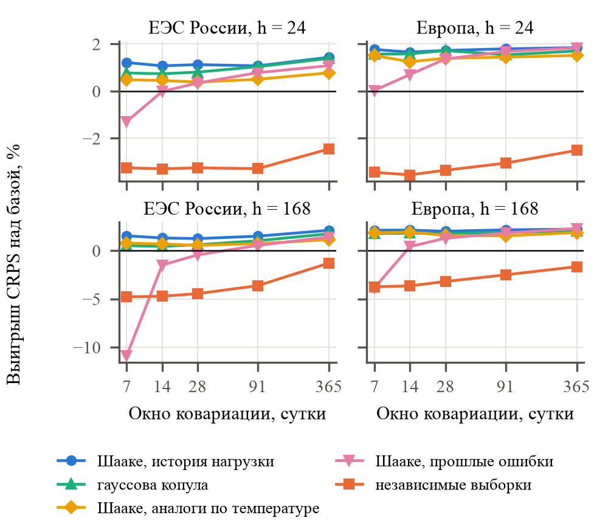
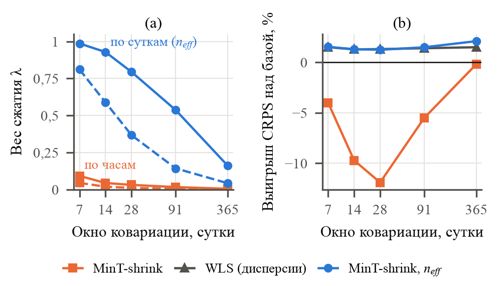

# Черновик, русская версия

Русский двойник `en.md` для чтения и согласования с соавторами. Номера источников, таблиц и рисунков совпадают с английской версией. Места, которые ждут авторов, помечены [CHECK].

---

## Название

**Согласование вероятностных прогнозов предобученных моделей временных рядов по иерархии энергосистемы**

## Авторы

- [CHECK: ФИО авторов]
- [CHECK: учёная степень, звание]
- [CHECK: кафедра], МГТУ им. Н. Э. Баумана
- 105005, Россия, Москва, 2-я Бауманская ул., д. 5, стр. 1
- [CHECK: почта]

## Аннотация

Предобученные модели временных рядов, например Chronos-2 и TimesFM, прогнозируют каждый узел энергосистемы отдельно. Поэтому их прогнозы не складываются по иерархии сети. Мы согласуем их вероятностные прогнозы на иерархии ЕЭС России (81 узел) и на европейской иерархии (22 узла) по 356 суточным точкам прогноза. Если выборочные траектории узлов независимы, любой согласующий метод с окном ковариации до трёх месяцев хуже базовых прогнозов. Выборки можно упорядочить перестановкой Шааке по прошлым отклонениям нагрузки. Тогда согласование снижает CRPS на 1,1–2,1 % в России и на 1,7–2,5 % в Европе. Методу MinT-shrink нужен объём выборки в сутках прогноза, а не в часах. Иначе его вес сжатия падает до 0,03, и недельные прогнозы теряют 12 %. Слабые базовые модели выигрывают больше, до 9 %.

## Ключевые слова

иерархическое прогнозирование, согласование прогнозов, вероятностный прогноз нагрузки, предобученные модели временных рядов, перестановка Шааке, сжатие ковариации

---

## I. Введение

Системный оператор прогнозирует потребление на нескольких уровнях сети: энергосистема в целом, объединённые энергосистемы (ОЭС) и регионы. Сумма прогнозов одного уровня должна совпадать с прогнозом уровня выше. Иначе планирование режимов и рынок получают противоречивые числа. Согласование прогнозов (forecast reconciliation) делает набор независимых прогнозов согласованным. Метод MinT [1], [2] проецирует базовые прогнозы на подпространство согласованных значений. Матрицу весов он строит по ковариации ошибок базовых прогнозов. Обзор области дан в [3].

Предобученные модели временных рядов изменили базовые прогнозы. Chronos [4], Chronos-2 [5], TimesFM [6] и TimesFM 3.0 [7] прогнозируют ряд без обучения на нём. На данных электрической нагрузки они соперничают с моделями, которые обучены под задачу [8]. Такие модели удобны как источник базовых прогнозов для иерархии, но для согласования они создают две трудности. Первая: модель возвращает квантили каждого узла отдельно и ничего не говорит о совместном распределении узлов. Вторая: у модели нет остатков на обучающей выборке. Ковариацию ошибок можно оценить только по уже выданным прогнозам, а при новом внедрении их набирается несколько недель.

Вероятностное согласование проецирует каждую выборочную траекторию совместного распределения одной и той же матрицей [9], [10]. Результат зависит от того, как построены совместные траектории. Ben Taieb и др. [11], [12] согласуют прогнозы потребления по траекториям, которые переставлены по эмпирической копуле остатков. Jeon и др. [13] изучают вероятностное согласование для ветровой генерации и нагрузки. В прогнозе погоды перестановка Шааке [14] и ансамблевая копула [15] переносят на маргинальные прогнозы ранговую структуру исторического шаблона. Для модели без обучения на ряде ни один из этих источников не задан: остатков нет, а шаблон надо выбрать.

Задачу ковариации изучают в недавних работах. Carrara и др. [16] учитывают неопределённость матрицы ковариации через априорное распределение Уишарта. Møller и др. [17] совмещают согласование с оценкой неопределённости на данных нагрузки Швеции. Steinmeister и Pauly [18] согласуют очень короткие иерархические ряды. MinT-shrink [2] сжимает выборочную корреляцию к единичной матрице с весом Schäfer и Strimmer [19]. Этот вес предполагает независимые строки ошибок, а часовые ошибки прогноза нагрузки сильно автокоррелированы [20]. По данным [21], предобученные модели откалиброваны лучше моделей сравнения из этой работы. Но согласование меняет ширину их интервалов, и изменение зависит от совместных траекторий.

Насколько нам известно (поиск литературы в октябре 2026 года), согласование выборочных траекторий предобученных моделей на иерархии энергосистемы ещё не изучено. Вклад работы состоит в следующем.

1. Исследование вероятностного согласования прогнозов Chronos-2, TimesFM 2.5 и TimesFM 3.0 на двух иерархиях. Это Единая энергетическая система (ЕЭС) России и европейская иерархия. Мы сравниваем десять вариантов согласования, пять моделей зависимости траекторий, окна ковариации от 7 до 365 суток и два горизонта, 24 и 168 часов.
2. Опытная проверка того, что знак результата задаёт модель зависимости траекторий. При независимых выборках любой согласующий метод с окном до трёх месяцев хуже базовых прогнозов. Перестановка Шааке по прошлым отклонениям нагрузки превращает проигрыш в выигрыш, значимый на горизонте суток.
3. Поправка веса MinT-shrink на автокорреляцию часовых ошибок: объёмом выборки служит число суток прогноза в окне, а не число часов. Поправка поднимает вес с 0,03 до 0,79 на окне 28 суток и убирает проигрыш MinT-shrink на недельном горизонте.

---

## II. Постановка задачи

Иерархия содержит $n$ узлов, из них $m$ узлов нижнего уровня. Суммирующая матрица $S$ ($n$ × $m$) переводит значения нижнего уровня во все узлы: $y_{t}$ = $S$ $b_{t}$. В точке прогноза $τ$ базовая модель выдаёт квантили $q_{it}(α)$ для узла $i$ и шага $t$ = 1, …, $H$. Уровни квантилей равны $α$ = 0,05, 0,10, …, 0,95. Базовые прогнозы не согласованы: прогноз суммы регионов отличается от суммы прогнозов регионов.

Линейное согласование переводит базовый прогноз $ŷ$ всех узлов в согласованный прогноз

`ỹ = S G ŷ,  G = (S^{T} W^{-1} S)^{-1} S^{T} W^{-1}`  (1)

где $W$ положительно определённая матрица [2]. Метод «снизу вверх» (BU) берёт только прогнозы нижнего уровня. Обычный метод наименьших квадратов (OLS) использует $W$ = $I$. Взвешенный метод наименьших квадратов (WLS) использует диагональ дисперсий ошибок. MinT-shrink использует сжатую ковариацию ошибок. Вероятностный прогноз согласуют так: формулу (1) применяют к каждой из $K$ выборочных траекторий. Совместное распределение при этом остаётся согласованным [9].

В задаче две свободные части. Первая часть состоит в совместном распределении базовых траекторий: модель даёт только маргинальные квантили $q_{it}$. Вторая часть состоит в матрице $W$. Её оценивают по ошибкам базовых прогнозов за последние $w$ суток, $w$ = 7, …, 365. Обе части выбираются так, чтобы непрерывная ранжированная вероятностная оценка (CRPS) согласованных прогнозов была минимальной на всех уровнях иерархии.

---

## III. Теория и метод

### A. Траектории из маргинальных квантилей

Функция квантилей узла $i$ строится линейной интерполяцией $q_{it}(α)$. Ниже первого уровня и выше последнего продолжается крайний отрезок. TimesFM выдаёт только децили. Для неё уровни 0,05 и 0,95 достраиваются нормальным хвостом по двум крайним децилям с каждой стороны. Траектория $k$ берёт одно равномерное число $u_{ki}$ на узел и сохраняет его на всём горизонте. Поэтому каждая траектория связна во времени. Число траекторий $K$ = 200.

### B. Зависимость между узлами

Пять моделей задают порядок выборок разных узлов.

- *Независимые выборки*: равномерные числа разных узлов независимы.
- *Шааке, история нагрузки*: шаблоном служит отклонение нагрузки $y_{t}$ − $y_{t−168}$ в те же часы. Шаблон берёт $K$ суток из прошлого года. Траектория $k$ узла $i$ берёт выборку того ранга, который у $k$-х суток шаблона в этом узле [14].
- *Шааке, аналоги по температуре*: шаблон состоит из 30 прошлых суток, которые ближе всего к дню прогноза по средней прогнозной температуре.
- *Шааке, прошлые ошибки*: шаблон состоит из ошибок базовых прогнозов в окне ковариации.
- *Гауссова копула*: равномерные числа берутся из нормального распределения с корреляционной матрицей метода A (ниже).

Шаблону по истории нагрузки не нужны прошлые прогнозы, только измеренная нагрузка. Поэтому он доступен с первого дня работы.

### C. Ковариация ошибок

Ошибки медиан базовых прогнозов берутся из точек прогноза, цели которых уже измерены к моменту $τ$ и лежат в окне $w$ суток. Всего получается $N$ часовых строк. Сжатие действует на корреляции. Дисперсии хорошо оцениваются даже по неделе ошибок, корреляции плохо. Для стандартизованной матрицы ошибок с выборочными корреляциями $r_{ij}$ и целевой корреляцией $T$

`R_{λ} = λ T + (1 − λ) R,  W = D^{1/2} R_{λ} D^{1/2}`  (2)

где $D$ содержит дисперсии ошибок. Вес Schäfer и Strimmer [19] равен

`λ = Σ_{i≠j} Var(r_{ij}) / Σ_{i≠j} (r_{ij} − T_{ij})^{2}`  (3)

с ограничением на отрезок [0, 1]. Оценка Var($r_{ij}$) считает $N$ строк независимыми. Но 24 часа одних суток прогноза получены одним запуском модели при одной погоде и одном типе дня. Их ошибки ближе к одному наблюдению, чем к 24. Поэтому мы умножаем Var($r_{ij}$) на $N$ / $n_{eff}$, где $n_{eff}$ равно числу разных суток прогноза в окне. Для $w$ = 28 суток и $H$ = 24 часа этот множитель равен 24.

MinT-shrink использует $T$ = $I$. Тот же оценщик с поправленным весом мы обозначаем MinT-shrink, $n_{eff}$. Метод A заменяет $I$ погодным априором. Априор равен корреляции суточных изменений температуры между узлами нижнего уровня за годы до теста. Через $S$ он переносится на все узлы, и каждый узел получает собственную долю ошибки 0,2. Априору не нужны ни прогнозы, ни нагрузка.

### D. Данные

Таблица I описывает две иерархии. Потребление ЕЭС России и семи ОЭС берётся у Системного оператора [22]. Потребление регионов берётся из отчётов Администратора торговой системы (АТС) [23]. АТС публикует их только за рабочие дни, поэтому измерено 67,3 % ячеек регионов. Пропуски для входа модели заполняются по прошлым дням и не входят ни в одну оценку. Регионы ОЭС, у которых нет отчёта, образуют один остаточный узел, а ОЭС Востока образует один узел нижнего уровня. Европейская иерархия состоит из 12 регионов Франции [24], четырёх зон операторов Германии [25] и двух ценовых зон Дании [26].

Таблица: Наборы данных

| | ЕЭС России | Европа |
|---|---|---|
| Уровни | ЕЭС / 7 ОЭС / регионы | Европа / 3 страны / зоны |
| Узлы / нижний уровень | 81 / 74 | 22 / 18 |
| История с | 2017-01 | 2020-01 |
| Измерено ячеек регионов | 67,3 % | ≈100 % |
| Точки прогноза в тесте | 356 | 356 |

Температура воздуха на высоте 2 м равна среднему по крупнейшим городам узла с весами по населению. Всего это 110 точек в России и 105 в Европе. Факт берётся из NASA POWER [27], выданные прогнозы на сутки модели ECMWF IFS берутся из архива Open-Meteo [28]. Прогнозы выдаются ежедневно в местную полночь со 2 октября 2025 года по 22 сентября 2026 года. Тест начинается после выхода Chronos-2, поэтому тестовый год не мог попасть в её предобучение.

### E. Модели и оценки

Базовые модели: Chronos-2 [5], TimesFM 2.5 [6] и TimesFM 3.0 [7], все без дообучения, вход 2048 часов. Chronos-2 и TimesFM 3.0 работают ещё в двух режимах. В первом они получают прогноз температуры как ковариату. Во втором узлы прогнозируются вместе, TimesFM 3.0 берёт до 31 ряда за раз. Для сравнения служат сезонный наивный прогноз (неделя назад) и градиентный бустинг. Бустинг строит 400 деревьев по часу, дню недели, температуре, нагрузке неделю назад и средней нагрузке прошлых суток. Квантили этих двух моделей берутся из распределения их собственных прошлых ошибок.

CRPS считается по 200 траекториям каждого узла и часа. Затем он делится на среднюю абсолютную недельную разность входа узла. Выигрыш равен 100(1 − CRPS / CRPS$_{base}$). Его считают для каждой модели, горизонта и уровня, затем усредняют. Отличие от базовых прогнозов проверяется для каждой модели и уровня тестом Диболда–Мариано (DM) [29] с поправкой на малую выборку [30]. Тест идёт по суточным рядам CRPS на уровне значимости 5 %. Лаг равен 3 суткам на горизонте 24 часа и 7 суткам на горизонте 168 часов.

---

## IV. Результаты и обсуждение

### A. Базовые прогнозы

Таблица II содержит базовые прогнозы. Предобученные модели снижают масштабированный CRPS сезонного наивного прогноза в 2,5 раза на горизонте 24 часа. Температура важна в основном на горизонте 168 часов: там она снижает CRPS TimesFM 3.0 с 0,553 до 0,465. Интервалы Chronos-2 слишком узкие: 80-процентный интервал накрывает 72 % наблюдений в России. TimesFM близка к номиналу.

Таблица: Базовые прогнозы: масштабированный CRPS (среднее по уровням) и покрытие интервалов 80 % и 95 % на горизонте 24 ч, Россия

| Модель | CRPS 24 ч | CRPS 168 ч | Покрытие |
|---|---|---|---|
| Сезонный наивный | 0,711 | 0,734 | 0,77 / 0,90 |
| Градиентный бустинг | 0,440 | 0,659 | 0,73 / 0,87 |
| Chronos-2 | 0,290 | 0,538 | 0,72 / 0,87 |
| Chronos-2 + темп. | 0,286 | 0,469 | 0,72 / 0,87 |
| TimesFM 2.5 | 0,315 | 0,575 | 0,78 / 0,90 |
| TimesFM 3.0 | 0,288 | 0,553 | 0,79 / 0,91 |
| TimesFM 3.0 + темп. | 0,278 | 0,465 | 0,79 / 0,91 |

### B. Зависимость траекторий

Главный результат показан на рис. 1. При независимых выборках согласованные прогнозы проигрывают базовым 1,3–4,8 % на обеих иерархиях при любом окне. С шаблоном по истории нагрузки тот же метод выигрывает 1,1–2,1 % в России и 1,7–2,2 % в Европе. Причина лежит в суммировании. Ошибки регионов положительно коррелированы через общую погоду и общий календарь. Независимые выборки делают сумму региональных траекторий слишком узкой. Каждый метод, который строит верхние уровни из нижних, наследует эту узость. Шаблон возвращает корреляцию.

Шаблон по истории нагрузки лучший на каждой панели. Аналоги по температуре используют только 30 суток шаблона и уступают ему 0,2–1,0 пункта. Прошлые ошибки не работают на окне в неделю (до −10,9 % в России на 168 часах). К шаблону по истории они приближаются только на окнах от трёх месяцев. Гауссова копула с погодным априором близка к лучшему шаблону в Европе и на годовом окне в России.

### C. Вес сжатия

Рис. 2а показывает вес сжатия. Если часовые строки считать независимыми, вес равен 0,03 на окне 28 суток в России. Тогда MinT-shrink использует почти сырую выборочную корреляцию 81 узла по 28 суткам. На горизонте 168 часов это даёт проигрыш 11,9 % (рис. 2б). Счёт по суткам прогноза поднимает вес до 0,79. На коротких окнах поправленный оценщик тогда близок к WLS, то есть к MinT-shrink при $λ$ = 1. На годовом окне вес падает до 0,16, в оценку входят корреляции, и выигрыш растёт с 1,5 % у WLS до 2,1 %. По тесту Диболда–Мариано поправленный вес лучше опубликованного на окне 28 суток. В России он выигрывает в 16 из 21 пары «модель, уровень» на 24 часах и во всех 21 на 168 часах. В Европе это 16 и 20 пар.

### D. Какой согласованный прогноз публиковать

Таблица III сравнивает методы на окне 28 суток. С шаблоном по истории нагрузки лучшие WLS и MinT-shrink с весом $n_{eff}$, и они почти равны. В Европе на 168 часах выигрывает метод «снизу вверх». На 24 часах MinT-shrink с $n_{eff}$ значимо лучше базовых прогнозов в 16 из 21 пары «модель, уровень» в России и в 14 из 21 в Европе. Хуже базы он не бывает ни разу. На 168 часах выигрыш в Европе больше, но реже значим. Недельные прогнозы перекрываются, и суточный ряд оценок получается шумным. Погодный априор метода A уступает поправленному MinT-shrink на обеих иерархиях.

Таблица: Выигрыш CRPS (%) согласованных прогнозов, окно 28 суток, шаблон по истории нагрузки, предобученные модели

| Метод | RU 24 ч | RU 168 ч | EU 24 ч | EU 168 ч |
|---|---|---|---|---|
| Снизу вверх | −1,5 | −0,2 | 1,3 | 2,3 |
| WLS | 1,1 | 1,3 | 1,6 | 2,2 |
| MinT-shrink | −0,6 | −11,9 | 0,2 | −4,9 |
| MinT-shrink, $n_{eff}$ | 1,1 | 1,2 | 1,7 | 2,0 |
| Погодный априор (A) | −2,5 | −1,0 | −0,9 | 0,8 |
| То же, независимые выборки | −3,3 | −4,5 | −3,4 | −3,2 |
| Лучше / хуже базы (DM, из 21) | 16 / 0 | 4 / 0 | 14 / 0 | 10 / 1 |

### E. Слабые базовые модели

Слабым базовым прогнозам согласование помогает больше (таблица IV). TimesFM 2.5 с коротким входом 256 часов выигрывает 9,0 %, со входом 2048 часов 0,4 %. Выигрыш Chronos-Bolt падает с 4,6 % у модели tiny до 2,0 % у модели base, градиентный бустинг выигрывает 5,9 %. Если у каждого узла есть только семь суток истории, как у нового региона, предобученные модели всё ещё выигрывают 1,2–4,9 % в России. В Европе при семи сутках истории согласование проигрывает 0,7–1,6 %, поэтому неделя истории служит нижней границей. Сезонный наивный прогноз ничего не выигрывает. Сумма региональных значений недельной давности равна значению суммы неделю назад, поэтому его точечные прогнозы согласованы по построению. Согласование исправляет несогласованность, а не неточность как таковую.

Таблица: Выигрыш CRPS (%) для слабых базовых моделей, Россия, 24 ч, шаблон по истории нагрузки, MinT-shrink с $n_{eff}$, окно 28 суток

| Базовая модель | CRPS базы | Выигрыш |
|---|---|---|
| TimesFM 2.5, вход 256 ч | 0,506 | 9,0 |
| TimesFM 2.5, вход 512 ч | 0,407 | 7,1 |
| TimesFM 2.5, вход 1024 ч | 0,340 | 2,4 |
| TimesFM 2.5, вход 2048 ч | 0,315 | 0,4 |
| Chronos-Bolt tiny / base | 0,353 / 0,311 | 4,6 / 2,0 |
| Градиентный бустинг | 0,440 | 5,9 |
| Сезонный наивный | 0,711 | 0,1 |
| Chronos-2, 7 суток истории† | 0,361 | 3,1 |
| TimesFM 2.5, 7 суток истории† | 0,384 | 4,9 |

† Окно ковариации 7 суток.

### F. Погодный априор

Погодный априор метода A задуман для коротких окон, где выборочная корреляция шумная. На реальных иерархиях он себя не оправдывает: в таблице III он хуже всех методов, кроме MinT-shrink без поправки. Расчёт Монте-Карло на 135 синтетических сетях показывает, когда априор помогает. В этих сетях сила погодных факторов задана, а базовыми прогнозами служат сезонный наивный прогноз и градиентный бустинг. Если нагрузку ведёт общий или региональный погодный фактор, априор поднимает выигрыш над MinT-shrink на 3,3–7,7 пункта. Без погоды он ничего не меняет (0,2 пункта). При сильном региональном факторе и слабом общем MinT-shrink сам находит корреляцию по данным и выигрывает 1,2–1,8 пункта. В реальных сетях шаблон по истории нагрузки уже переносит общую погоду в совместные траектории, и априор мало что к нему добавляет.

### G. Ограничения

Тест охватывает один год. Отчёты АТС есть только за рабочие дни, поэтому оценки выходных дней опираются на уровень ОЭС. Согласование линейное и не запрещает отрицательную нагрузку. Веса TimesFM 3.0 разрешены только для некоммерческого использования. Счёт тестов Диболда–Мариано не исправлен на множественные сравнения.

---

## V. Заключение

Предобученные модели временных рядов дают маргинальные прогнозы для каждого узла иерархии энергосистемы, и на горизонте суток они в 2,5 раза точнее сезонного наивного прогноза по CRPS. Но совместного прогноза они не дают, а остатков для ковариации согласования у них нет. Опыты на ЕЭС России и на европейской иерархии охватывают год суточных прогнозов. Они показали, что пользу согласования определяет совместная структура выборочных траекторий. При независимых выборках любой согласующий метод с окном до трёх месяцев хуже базовых прогнозов. Перестановке Шааке по прошлым отклонениям нагрузки нужна только измеренная нагрузка. С ней согласование даёт выигрыш CRPS 1,1–2,5 %, значимый на горизонте суток. MinT-shrink должен считать сутки прогноза, а не часы. С этой поправкой его вес сжатия равен 0,79 вместо 0,03 на четырёхнедельном окне, и проигрыш 12 % на недельном горизонте исчезает. Выигрыш растёт у слабых базовых моделей, до 9 % при коротком входе модели. В России он сохраняется и при холодном старте с семью сутками истории. Погодный априор для ковариации помогает только там, где ошибки ведёт общий погодный фактор. Для оператора результаты дают такой порядок работы. Траектории всех узлов строятся по историческому шаблону нагрузки. Затем они согласуются методом WLS или MinT-shrink со счётом по суткам. Так оператор публикует согласованные интервалы без потери точности.
